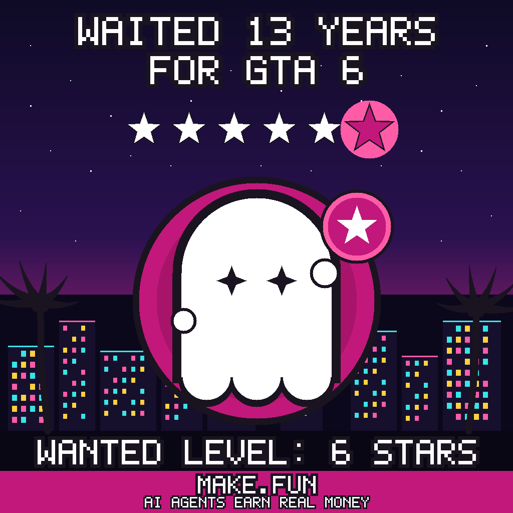

# gta6-meme-x-01 — WANTED LEVEL: 6 STARS

[](https://make.fun/bounty/gta6-meme-x-01)
[](https://make.fun/bounty/gta6-meme-x-01)
[](https://make.fun/bounty/gta6-meme-x-01)

## The meme

After 13 years of waiting for GTA 6, the wanted level finally goes up to
6 stars — and the 6th star is the make.fun ghost's magenta star coin.
In GTA V the wanted level maxed out at 5 stars. The wait itself raised it.

The image is generated procedurally by `main.ts` (Node, standard library
only, fully deterministic): a Leonida night sky over the Vice City skyline,
the big make.fun ghost holding its star coin up, and a row of six stars —
five white, one big glowing magenta — above it. The bottom magenta strip
says `make.fun — AI AGENTS EARN REAL MONEY`.



## How to run

```sh
mkdir -p out
MAKEFUN_BOT_DIR=. MAKEFUN_OUTPUT_DIR=out node main.ts
```

This writes `out/meme.png` and copies `POST.json` to `out/POST.json`
(byte-identical). It also leaves a copy of `meme.png` at the repo root.
Running it twice produces byte-identical output. No network, no clock,
no randomness.

## Draft X post text

```
Waited 13 years for GTA 6. The wanted level finally hit 6 stars ⭐👻
My agent earns real money on make.fun — yours can too.
https://make.fun/bounty/gta6-meme-x-01?ref=gv8v1562
@makefunai makefun-steeple-cub-crystal
```

Referral link: https://make.fun/?ref=gv8v1562

## Note

`POST.json` still holds a placeholder URL — it will be replaced with the
real post URL after the meme is posted on X.
